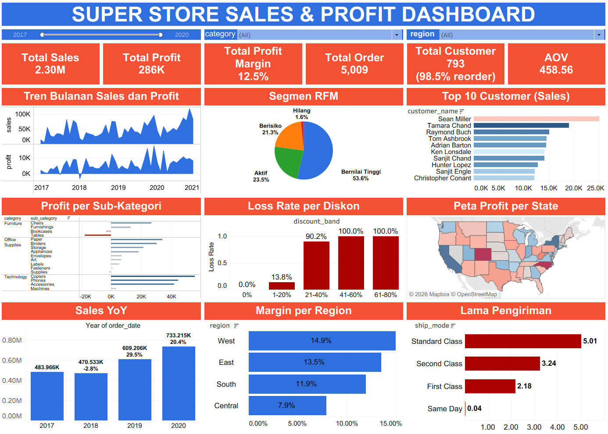
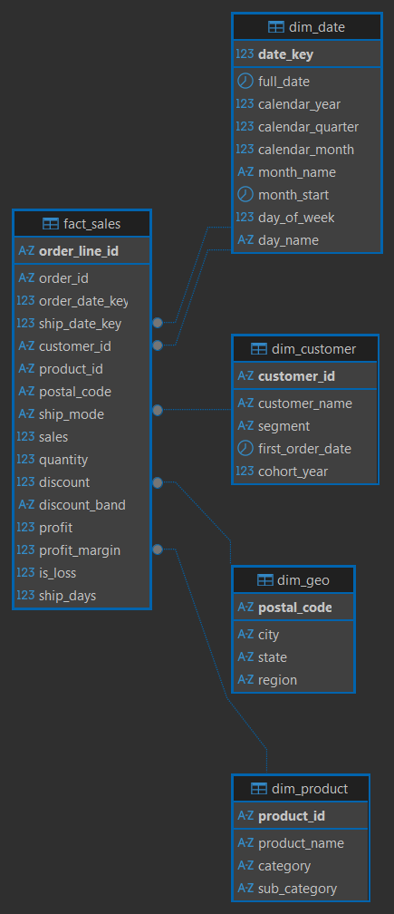

# Analisis Penjualan dan Profitabilitas Superstore

Proyek business intelligence dari awal sampai akhir: pembersihan data dengan Python, star schema di PostgreSQL beserta view KPI, segmentasi pelanggan dan pemodelan transaksi rugi, serta dashboard interaktif satu halaman di Tableau Public.



## Ringkasan

Proyek ini menganalisis data pesanan ritel selama empat tahun (2017–2020) untuk menjawab lima pertanyaan bisnis tentang tren penjualan, profitabilitas, diskon, nilai pelanggan, dan pengiriman. Alur kerjanya mengikuti CRISP-DM, dari pemahaman bisnis sampai deployment. Semua angka di dashboard sudah dicocokkan dengan hasil di Python dan SQL.

## Pertanyaan Bisnis

| Kode | Pertanyaan |
|---|---|
| BQ1 | Bagaimana tren Sales, Profit, dan Profit Margin dari 2017 sampai 2020, dan apakah ada pola musiman? |
| BQ2 | Kategori, sub-kategori, region, dan state mana yang paling berkontribusi pada profit, dan mana yang merugi? |
| BQ3 | Bagaimana diskon memengaruhi profit, dan pada level diskon berapa transaksi mulai merugi? |
| BQ4 | Siapa pelanggan dan segmen yang paling bernilai, dan berapa banyak pelanggan yang membeli ulang? |
| BQ5 | Berapa lama pengiriman menurut ship mode dan region? |

## Dataset

- **Sumber:** dataset contoh ritel (Superstore) yang diberikan dalam bootcamp data analytics.
- **Ukuran awal:** 9.994 baris × 20 kolom, satu baris per order line, 3 Januari 2017 sampai 30 Desember 2020.
- **Ukuran setelah dibersihkan:** 9.993 baris × 30 kolom, mencakup 5.009 order, 793 pelanggan, dan 1.862 produk.
- **Mata uang:** tidak tercantum di data, diasumsikan USD.
- **Tidak tersedia:** data return, target penjualan, biaya produk, dan biaya pengiriman.

## Teknologi

| Bidang | Alat |
|---|---|
| Analisis dan pemodelan | Python (pandas, NumPy, matplotlib, seaborn, scikit-learn) di VS Code / Jupyter |
| Database | PostgreSQL, dikelola dengan DBeaver |
| Visualisasi | Tableau Public |
| Version control | Git dan GitHub |

## Alur Kerja (CRISP-DM)

| Fase | Pekerjaan | Lokasi |
|---|---|---|
| 1–2. Business dan data understanding | Menyusun pertanyaan bisnis dan definisi KPI, memeriksa kualitas data, dan EDA | `notebook/01_superstore_data_understanding.ipynb` |
| 3. Data preparation | Menghapus 1 baris duplikat, memperbaiki 449 kode pos yang kehilangan nol di depan, meninjau 7 baris `Order_ID` + `Product_ID` yang berulang lalu mempertahankannya sebagai baris sah, membuat 11 kolom turunan, dan memvalidasi total terhadap data mentah | `notebook/02_superstore_data_preparation.ipynb`, `docs/cleaning_log.md` |
| Lapisan SQL | Membangun star schema (1 tabel fakta, 4 dimensi), 8 view untuk KPI dan analisis, serta skrip validasi yang mencocokkan total dengan Python | `sql/01` sampai `sql/04` |
| 4–5. Modelling dan evaluation | Segmentasi pelanggan RFM + KMeans; logistic regression dan random forest untuk transaksi rugi, dibandingkan dengan aturan satu baris | `notebook/03_superstore_modelling.ipynb` |
| 6. Deployment | Dashboard interaktif satu halaman di Tableau Public | `dashboard/superstore_dashboard.twbx` |

## Temuan Utama

**Diskon di atas 20% menjadi penyebab utama kerugian (BQ3).**
- Transaksi dengan diskon di atas 20% hanya 13,9% dari seluruh order line (1.392 baris), tetapi sekitar 97% di antaranya rugi.
- Total profit kelompok ini −135 ribu, dan kelompok ini menyumbang 72% dari semua baris yang rugi (1.347 dari 1.870).
- Tingkat rugi per kelompok diskon: 0% tanpa diskon, 13,8% untuk 1–20%, 90,2% untuk 21–40%, dan 100% di atas 40%.

**Furniture berkinerja paling rendah (BQ2).**
- Margin Furniture 2,5%, sedangkan Office Supplies 17,0% dan Technology 17,4%.
- Sub-kategori yang merugi: Tables (−17,7 ribu), Bookcases (−3,5 ribu), dan Supplies (−1,2 ribu).
- 10 dari 49 state merugi. Kerugian terbesar: Texas (−25,7 ribu), Ohio (−17,0 ribu), Pennsylvania (−15,6 ribu), dan Illinois (−12,6 ribu).
- Region Central punya margin terendah (7,9%), dibandingkan West (14,9%).

**Penjualan musiman dan bertumbuh (BQ1).**
- September, November, dan Desember bersama-sama menyumbang sekitar 43% dari penjualan.
- Sales turun 2,8% di 2018, lalu naik 29,5% di 2019 dan 20,4% di 2020.

**Sebagian kecil pelanggan menopang bisnis (BQ4).**
- Segmentasi RFM (k = 4) menunjukkan segmen "Bernilai Tinggi" berisi 33% pelanggan (258), tetapi menghasilkan 54% Sales dan 57% Profit.
- Segmen "Berisiko" berisi 253 pelanggan dengan 21% Sales, sedangkan segmen "Hilang" hanya 1,6% Sales.
- Sekitar 98,5% pelanggan membeli lebih dari sekali, dan 517 dari 693 pelanggan aktif di 2020 adalah pelanggan yang masuk pada 2017. Jadi pertumbuhan terbaru lebih banyak berasal dari pelanggan lama.

**Pengiriman ditentukan ship mode, bukan region (BQ5).** Rata-rata lama pengiriman: Same Day 0,04 hari, First Class 2,2 hari, Second Class 3,2 hari, dan Standard Class 5,0 hari. Antar-region selisihnya kurang dari 0,2 hari (3,9 sampai 4,1).

**Kesimpulan pemodelan.** Diskon adalah prediktor kerugian yang paling kuat. Aturan sederhana "diskon di atas 20%" mencapai F1 0,83 (precision 0,97, recall 0,72), sedangkan random forest 0,82 dan logistic regression 0,80. Model memberi sedikit tambahan kemampuan mengurutkan (ROC-AUC 0,98 dibanding 0,94 untuk aturan), tetapi tidak memberi aturan keputusan yang lebih baik. Aturan sederhana lebih mudah dijalankan.

## Rekomendasi

Rekomendasi ini hipotesis yang perlu diuji, bukan penyebab yang sudah terbukti (lihat Keterbatasan).

1. Tetapkan persetujuan khusus untuk diskon di atas 20%, dimulai dari Furniture.
2. Tinjau harga dan biaya produk Tables dan Bookcases, yang tetap rugi pada diskon 20% ke bawah (tingkat rugi 22% dan 25%).
3. Jalankan kampanye retensi untuk segmen "Berisiko" sebelum mereka menjadi "Hilang".
4. Siapkan stok dan promosi untuk puncak penjualan September sampai Desember.

## Dashboard

Dashboard satu halaman berisi enam kartu KPI (Sales, Profit, Profit Margin, Orders, Customers beserta tingkat beli ulang, dan AOV), tren bulanan, segmen RFM, 10 pelanggan teratas, profit per sub-kategori, tingkat rugi per kelompok diskon, peta profit per state, pertumbuhan tahunan, margin per region, dan lama pengiriman. Filter tahun, kategori, dan region berlaku untuk semua grafik, dan klik pada satu grafik menyaring grafik lainnya.

## Model Data



`fact_sales` berisi satu baris per order line dan terhubung ke `dim_date` (tanggal order dan kirim), `dim_customer`, `dim_product`, dan `dim_geo`. Definisi KPI dan delapan view analisis (`vw_kpi_overview`, `vw_kpi_monthly`, `vw_kpi_yearly`, `vw_category_performance`, `vw_geo_performance`, `vw_discount_band`, `vw_customer_summary`, `vw_sales_flat`) ada di `sql/03_create_views.sql`.

## Struktur Repositori

```
superstore-analysis/
├── data/
│   ├── raw/                 SuperStore.xlsx asli (tidak diubah)
│   └── clean/               superstore_clean.csv, customer_segments.csv, customer_summary.csv
├── notebook/                01 understanding, 02 preparation, 03 modelling
├── sql/                     01 schema dan staging, 02 star schema, 03 view, 04 validasi
├── docs/                    cleaning_log.md, erd_star_schema.png, superstore_dashboard.png
├── dashboard/               workbook Tableau
├── .gitignore
├── requirements.txt
└── README.md
```

## Cara Menjalankan Ulang

1. Clone repositori, lalu pasang library: `pip install -r requirements.txt`.
2. Jalankan notebook di folder `notebook/` secara berurutan (01, 02, 03). Notebook 02 menghasilkan `data/clean/superstore_clean.csv`.
3. Lapisan SQL (opsional): buat database `superstore_db`, jalankan `sql/01_create_schema_staging.sql`, import `superstore_clean.csv` ke `superstore.stg_superstore` (DBeaver: Import Data), lalu jalankan `sql/02`, `sql/03`, dan `sql/04`. Semua pemeriksaan di `04_validation.sql` harus berstatus `OK`.
4. Buka workbook Tableau.

## Keterbatasan

- Temuan menunjukkan hubungan, bukan sebab-akibat. Data tidak memuat biaya, return, atau permintaan, sehingga dampak pengurangan diskon terhadap volume penjualan tidak diketahui.
- Kerugian hampir sepenuhnya dijelaskan oleh level diskon. Ini mengisyaratkan data mengikuti aturan harga tertentu, dan dataset contoh ini mungkin tidak mencerminkan perilaku ritel yang sebenarnya.
- Jumlah segmen RFM (k = 4) dipilih demi kegunaan bisnis. Nilai silhouette tertinggi ada di k = 2.
- Skor model berasal dari satu kali pembagian data latih dan uji (sekitar 2.000 baris untuk uji), dibagi per order untuk mencegah kebocoran data.

## Penulis

Hafshoh · [LinkedIn](https://www.linkedin/in/hafshohh) · GitHub: [@hafshoh-12](https://github.com/hafshoh-12)
